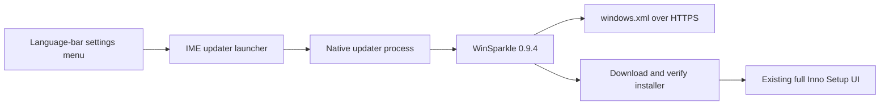

Plan: Integrate WinSparkle for manual update checks from the language-bar settings menu.

Status: Planned (2026-11-17).


# WinSparkle Integration Roadmap

## Confirmed Product Requirements

- Use WinSparkle 0.9.4 as the initial integration version.
- Check the Windows appcast at `https://jyutping.app/windows.xml`.
- Reuse the Mac application's Ed25519 signing key. Embed this public key:
  `MaIeb2a5zTv+hpwycNCYXmPBxMr1+eho9PQmHJjZkNk=`.
- Update checks run only after a user selects `Check for updates`. Disable automatic checking explicitly, including WinSparkle's initial permission prompt. Do not add background checks, startup checks, scheduled tasks, or an automatic-check preference.
- Place the enabled, localized `Check for updates` command immediately above the disabled `Version` label in the language-bar settings menu. Both menu presentations must share this ordering.
- After the user chooses to install a downloaded, verified update, launch the full existing Inno Setup installer UI. The user confirmed this choice during planning. Keep its UAC and restart prompts.

## Findings And Reference Material

References inspected when preparing this roadmap:

| Reference | Relevant findings |
| --- | --- |
| `C:\Users\bing\github\WinSparkle-0.9.4` | Release SDK with public headers, x64/ARM64/Win32 import libraries and DLLs, `bin\winsparkle-tool.exe`, and redistribution notices. The bundled header identifies version 0.9.4. |
| `C:\Users\bing\github\winsparkle` | API implementation, examples, appcast parser, signing tool source, documentation, and `NEWS`. Its header currently identifies development version 0.10.0; use it for explanation and verify behavior against the pinned 0.9.4 binaries. |
| `C:\Users\bing\github\apple-jyutping\InputMethod\Info.plist` | `SUPublicEDKey` matches the public key above. Its `SUFeedURL` is the separate Mac feed, `https://jyutping.app/appcast.xml`. |
| `C:\Users\bing\github\apple-jyutping\InputMethod\AppDelegate.swift` | Owns the Mac Sparkle controller and exposes the user-triggered check operation. The Windows integration needs a different process lifecycle because it is a TSF DLL. |
| `C:\Users\bing\github\website\appcast.xml` | The website serves its Mac feed directly from the repository root. Add the Windows feed as a sibling file, `windows.xml`. |
| `C:\Users\bing\github\website\windows\index.html` | Existing downloads use `https://dl.jyutping.app/jyutping-windows/<version>/jyutping-v<version>-x64.exe` and the corresponding `-arm64.exe` URL. |

The Windows application currently has one DLL project in `Jyutping.sln`. `SettingsMenu::BuildSnapshot()` in `Jyutping\SettingsMenuModel.cpp` supplies both the custom popup in `SettingsMenuWindow.*` and the native TSF `ITfMenu` surface. Commands converge on `CLangBarItemButton::OnMenuSelect()` in `LanguageBar.cpp`. The snapshot ends with a separator and the disabled version label.

The current release version is `0.11.0` in the DLL resources, localized version labels, and packaging defaults. Some older plans and example filenames still mention `0.1.0`; use the actual source and selected release version when implementing this work.

Packaging produces two installers. The x64 package installs x64 and x86 IME DLLs in their respective Program Files directories. The ARM64 package installs the ARM64X root DLL built with `Release|ARM64EC`, with no x86 fallback. Both packages use an existing stable Inno Setup AppId, require administrator privileges, unregister/register the IME, and use `restartreplace` for the IME DLL. These behaviors shape the update design.

## Architecture

Add a small native Windows executable, provisionally `JyutpingUpdater.exe`, that owns WinSparkle. The IME launches it only for a manual check. Give the helper its own C++ project, resources, message loop, and process lifetime.



Loading WinSparkle into the IME would put its worker threads and dialogs inside arbitrary host applications, potentially once per host process. A helper gives the updater a lifetime independent of composition and host shutdown. Its shutdown callback closes only the helper. Application processes containing the IME must remain under their users' control.

### Architecture And Installation Routing

| Installed package / invoking host | Updater and WinSparkle DLL | Feed enclosure |
| --- | --- | --- |
| x64 installation, x64 host | x64 helper + x64 WinSparkle | `sparkle:os="windows-x64"` |
| x64 installation, x86 host | The same x64 helper + x64 WinSparkle | `sparkle:os="windows-x64"` |
| ARM64 installation, native ARM64 host | Native ARM64 helper + ARM64 WinSparkle | `sparkle:os="windows-arm64"` |
| ARM64 installation, emulated x64 host using the ARM64X IME | The same native ARM64 helper + ARM64 WinSparkle | `sparkle:os="windows-arm64"` |

WinSparkle's architecture filter follows the architecture of its own DLL, rather than the native OS or the IME caller. Launching the native helper is essential on both x86-on-x64 and x64-on-ARM64 paths. WinSparkle's `NEWS` records ARM-specific and multiple-enclosure support in 0.8.2, before the selected 0.9.4 release.

Install one helper and its matching WinSparkle DLL under `{app}\Updater\`, where `{app}` is the native 64-bit Jyutping installation directory. Keep the x86 IME payload in its current location. The helper itself uses native ARM64, independently of the IME's ARM64EC/ARM64X build.

Have the installer write a canonical native installation path to `HKLM\Software\Jyutping`, value `InstallPath`, in the 64-bit registry view. The launcher reads that view explicitly from either IME architecture and constructs an absolute helper path. This avoids interpreting the host executable's location or an x86 process's Program Files view as the native install directory. Remove the installation value on uninstall without deleting unrelated settings.

## Milestone 1: Pin The SDK And Establish Versioning

Deliverable: reproducible helper builds using the 0.9.4 release, with correct product metadata.

- Import the required release headers, x64/ARM64 libraries and DLLs, signing tool, and complete upstream notices into a versioned dependency location such as `third_party\WinSparkle\0.9.4\`. Record the upstream release URL and SHA-256 values. Ensure Git ignore patterns do not silently exclude required payloads. Ordinary builds must not depend on either sibling checkout or a developer-specific absolute path.
- Link the helper to the matching WinSparkle import library and deploy its DLL next to the executable. Keep the IME's imports independent of WinSparkle. Use the executable directory for bundled DLL resolution, and verify any additional runtime dependencies on a clean machine.
- Add `JyutpingUpdater\JyutpingUpdater.vcxproj` and its filters to the solution. Use the repository's C++ toolchain and Windows subsystem; provide `Debug` and `Release` for x64 and native ARM64.
- Map solution x64 to helper x64, and solution ARM64/ARM64EC to helper ARM64. Give the helper an output directory independent of the IME's ARM64EC output. Keep Win32 IME builds valid without introducing a shipped x86 updater or a new 32-bit Windows installer.
- Establish one release-version source for the IME, helper, installer metadata, and appcast generation. Align localized version labels with it. The current `-AppVersion` packaging argument affects installer metadata but does not stamp the compiled IME; resolve that mismatch before enabling update comparisons. Reject mismatched payload versions, including with `-SkipBuild`.
- Use the Windows product version, initially `0.11.0`, for comparisons. Do not reuse the Mac feed's independent integer build counter. A separate `win_sparkle_set_app_build_version()` scheme is unnecessary for the initial numeric Windows releases.

Acceptance: a clean checkout can build the helper without external source directories; its version matches the packaged IME. The ordinary verification build remains `Debug|ARM64`.

## Milestone 2: Implement The Manual Updater Process

Deliverable: a helper that performs one explicit check and exits after the interaction finishes.

1. Accept a narrow operation such as `--check-for-updates`; keep the production feed URL and public key embedded in the helper. Initialize the helper's Windows message loop and lifetime management before starting the asynchronous interaction.
2. Enforce one active updater per user/logon session across all IME host processes. Use a named synchronization object and a small activation mechanism so another click presents the current updater interaction. Repeated clicks must not start parallel downloads or installers.
3. Before `win_sparkle_init()`, configure the following in order:
   - Product identity with `win_sparkle_set_app_details(L"Jyutping.org", L"Jyutping", currentVersion)`.
   - A stable updater settings path, for example `win_sparkle_set_registry_path("Software\\Jyutping\\WinSparkle")`, kept separate from input settings and input memory.
   - `win_sparkle_set_appcast_url("https://jyutping.app/windows.xml")`.
   - `win_sparkle_set_eddsa_public_key("MaIeb2a5zTv+hpwycNCYXmPBxMr1+eho9PQmHJjZkNk=")`; require a return value of `1` and report a configuration error otherwise.
   - `win_sparkle_set_automatic_check_for_updates(0)` on every launch, even if saved WinSparkle settings previously enabled checking. Setting it before initialization also avoids the first-run/second-run automatic-check permission dialog.
   - Lifecycle, error, and dismissal callbacks, plus UI language selection where needed.
4. Call `win_sparkle_init()`, then `win_sparkle_check_update_with_ui()` for the requested manual operation. This provides checking progress, update availability, errors, and the up-to-date result. Preserve its documented behavior that a manual check ignores an earlier skipped version.
5. Keep the helper alive through checking, download, verification, and user interaction. Finding no update or encountering an error must leave WinSparkle's result dialog visible until dismissed; those notification callbacks are not exit signals.
6. Use `win_sparkle_set_update_dismissed_callback()` for normal completion and `win_sparkle_set_shutdown_request_callback()` for the successful installer handoff. The shutdown request follows installer launch. Marshal callbacks to the helper's main thread, and call `win_sparkle_cleanup()` there after the callback returns, then exit. Make completion idempotent. Avoid cleanup from a WinSparkle callback thread.
7. Let WinSparkle verify and launch the downloaded EXE through its normal installer path. Use the full interactive installer with no `/SILENT` or `/VERYSILENT` arguments. Restrict elevation to the installer for a normal unelevated launch; verify behavior when the IME host is already elevated.

Use the Windows UI language and existing supported translations for the initial integration. Verify the language behavior of the bundled 0.9.4 UI. Cantonese (`yue`) must retain its own identity; do not label a Traditional Chinese fallback as Cantonese or force `yue` to mean `zh-Hant-HK`. Additional upstream translations can be a separate task if needed.

Acceptance: repeated checks create one interaction, automatic checks and opt-in prompts never appear, all result dialogs remain readable, and the helper exits cleanly on dismissal or installer handoff. Validate these lifecycle assumptions with the actual 0.9.4 DLLs before menu integration.

## Milestone 3: Connect The Language-Bar Menu

Deliverable: the localized command launches the installed helper from both menu presentations.

- Add a unique `SettingsMenu::CheckForUpdates` command ID in `SettingsMenuModel.h`. Preserve existing command IDs where practical; append a new ID and control placement through the snapshot.
- Add the command to the shared snapshot after the existing separator and immediately before `Version`. Reuse the current popup and `ITfMenu` renderers and command dispatch.
- Add `IDS_MENU_CHECK_FOR_UPDATES` in `resource.h` and labels to all six existing `Strings.*.rc2` files. The English label is `Check for updates`; review Chinese labels in their existing resource contexts. Localize launch/configuration failures as well.
- Handle the command in `CLangBarItemButton::OnMenuSelect()` through a small launcher, provisionally `UpdaterLauncher.h/.cpp`. Launch using the absolute installed path and return promptly without waiting for the update session. Add new IME files to both `Jyutping.vcxproj` and its filters.
- Close the custom popup before launching the helper, following the current `ShowSettingsMenu()` command-dispatch sequence. Keep composition and input processing responsive during the check.
- Handle a missing helper, missing install-path value, process-launch failure, restricted host, and unavailable installation with a localized actionable error. Do not fall back to searching `PATH` or loading WinSparkle in the host. Validate secure/restricted desktop behavior within the existing TSF constraints.
- For developer-only DLL registration outside the installers, document how to stage the helper and register its location, or report that the updater is unavailable. Ordinary typing must remain usable without updater files.

Acceptance: mouse, keyboard, and accessibility invocation work in both menu surfaces; `Check for updates` appears immediately above the disabled version label; checking continues if the invoking host closes.

## Milestone 4: Extend Packaging And Handle Loaded IME Files

Deliverable: both existing installers deploy and upgrade the helper alongside the IME.

- Extend `packaging\Build-Installers.ps1` to build the native ARM64 helper in addition to the current IME release payloads. Its existing ARM64EC solution build may produce the mapped ARM64 helper; avoid building it twice. Stage each helper with its matching SDK DLL and upstream notices, and include the helper in existing optional Authenticode signing.
- Add `{app}\Updater\JyutpingUpdater.exe`, `{app}\Updater\WinSparkle.dll`, and notices to the appropriate installer. Leave the x64 package's x86 IME layout and ARM64 package's ARM64X root layout intact.
- Update `Jyutping.common.iss`, `Jyutping-x64.iss`, and `Jyutping-ARM64.iss` for the canonical install-path value, updater files, and upgrade/uninstall cleanup. Preserve the AppId, registration sequence, installation directories, and generated `unins000.exe`/Apps & Features entry.
- Exercise replacing the helper and WinSparkle DLL while the helper is completing its installer handoff. Account for its process lifetime in file-in-use handling, and validate whether restart replacement is needed for these new files.
- Treat IME DLLs and the read-only lexicon database as potentially in use by other processes. Existing `restartreplace` flags on the IME DLLs do not prove that the whole upgrade is coherent, especially when the database is also open. Verify and adjust file replacement/registration sequencing so failed or deferred updates do not leave a mixed installation.
- Keep the full installer UI responsible for upgrade failures, retry, and required restart prompts. Review Inno Setup Restart Manager behavior so upgrading never forcibly terminates applications containing unsaved documents, and never triggers an unattended reboot. Explain when restarting applications, signing out, or restarting Windows is needed to load the new IME.
- Preserve persistent settings and input-memory data through update, cancellation, and failed installation. Keep checking/downloading under the user's identity; installing retains the existing machine-wide UAC flow.

Acceptance: both installed packages can update themselves, with hosts actively using the IME, and remain functional after any required restart. Uninstall removes updater files and installation metadata through the existing uninstaller.

## Milestone 5: Generate Signed Release Metadata And Publish The Feed

Deliverable: final installers, verified Ed25519 signatures, checksums, and a generated Windows appcast ready for website publication.

### Signing Workflow

Reuse the existing private key through the Mac release signing environment, or an explicitly provisioned secret file compatible with WinSparkle's tool. Confirm compatibility by verifying a signed Windows installer against the fixed public key. The inspected WinSparkle tool source accepts both a base64 32-byte seed and Sparkle's older 96-byte key format; verify the selected release tool with the actual signing workflow before first publication.

The private key stays in the release signing environment. Neither source control nor installer payloads need it. Do not generate a replacement key. Authenticode signing in the existing packaging script and Sparkle's Ed25519 signatures serve separate purposes; retain the optional Authenticode path.

Release order:

1. Build and stage matching-version binaries; Authenticode-sign product binaries if enabled.
2. Compile both installers and finish any Authenticode signing/timestamping of the EXEs.
3. Ed25519-sign each final installer independently. Example commands, with a provisioned private-key file outside the repository:

   ```powershell
   & $WinSparkleTool sign --private-key-file $ReleasePrivateKeyFile --verbose $X64Installer
   & $WinSparkleTool sign --private-key-file $ReleasePrivateKeyFile --verbose $Arm64Installer
   ```

4. Verify each signature using the bundled 0.9.4 tool, the exact public key, and the final installer bytes:

   ```powershell
   & $WinSparkleTool verify --public-key 'MaIeb2a5zTv+hpwycNCYXmPBxMr1+eho9PQmHJjZkNk=' --signature $InstallerSignature $InstallerPath
   ```

5. Generate exact byte lengths, `SHA256SUMS.txt`, and appcast metadata from those same files. Existing checksum generation already follows optional installer signing; preserve that ordering. Any later installer modification requires new signatures, lengths, and checksums.
6. Upload versioned installers and release notes first, verify the downloaded bytes and signatures, then publish `windows.xml`. A feed must never advertise unavailable artifacts.

Add release tooling such as `packaging\New-WindowsAppcast.ps1` to generate and validate metadata. Keep secret-dependent release signing separate from ordinary development builds. Fail release metadata generation for a missing signature, incorrect version, incorrect length, failed verification, or unsupported architecture.

### Feed Contract

Create `C:\Users\bing\github\website\windows.xml`. Keep Windows version history separate from the Mac appcast. Use RSS 2.0 with `xmlns:sparkle="http://www.andymatuschak.org/xml-namespaces/sparkle"` and HTTPS URLs throughout.

Use two items per Windows release, one per architecture, so each can declare its own minimum supported Windows version. Keep newest releases first for readability. Each item contains:

| Field | Value / rule |
| --- | --- |
| `title` | Jyutping version and architecture |
| `pubDate` | Actual release date in RFC 2822 format |
| `sparkle:version` | The Windows numeric product version used by the helper |
| `sparkle:shortVersionString` | The matching user-visible Windows release version |
| `sparkle:minimumSystemVersion` | The actual supported Windows floor for that package |
| Release notes | Inline description or an HTTPS `sparkle:releaseNotesLink`, tested with the bundled UI |
| Enclosure `url` | Existing `dl.jyutping.app/jyutping-windows/<version>/` URL pattern for that architecture |
| Enclosure `sparkle:os` | Exactly `windows-x64` or `windows-arm64` |
| Enclosure `sparkle:edSignature` | That installer's verified base64 Ed25519 signature |
| Enclosure `length` | That final installer's exact byte count |
| Enclosure `type` | `application/octet-stream` |
| Enclosure `sparkle:installerArguments` | Omit for the confirmed full installer UI |

For x64, retain the project's Windows 10 baseline where supported. For ARM64, verify the Windows 11 floor required by the existing ARM64X payload and installer architecture checks; the expected baseline is `10.0.22000`. Do not advertise that payload to Windows 10 on ARM merely because the helper itself can run there. Align the verified package requirements with the Windows website pages.

Give every downloadable enclosure an explicit architecture. A generic `windows` enclosure could offer the wrong installer. Validate that equal-version x64/ARM64 items select correctly regardless of their XML order and that an unsupported architecture/OS receives no incompatible download.

Coordinate Windows release version, links, checksums, and release notes across `windows\index.html`, `en\windows\index.html`, `cmn-Hans\windows\index.html`, and `cmn-Hant\windows\index.html` when publishing. Apply the website repository's metadata conventions, including sitemap dates when appropriate.

Acceptance: both helper architectures consume the same feed URL and download only their corresponding correctly signed installer. Feed generation rejects stale or incomplete metadata.

## Milestone 6: Validation And Rollout

No application build is needed to review this roadmap. During implementation, use `Debug|ARM64` for routine verification as required by `AGENTS.md`. Release validation additionally needs the two helper architectures and the current installer payload builds; run broader builds only for those integration/release gates.

Update `.github\workflows\build.yml` so helper, dependency, shared-version, and packaging changes trigger the relevant jobs. Its current path filters omit new top-level helper/dependency directories and packaging. Archive usable updater payloads with their matching DLLs. Validate generated feed structure, version consistency, and signature verification in the release workflow; routine pull-request builds must not require the production signing key.

| Scenario | Required result |
| --- | --- |
| Fresh install, repeated logins, ordinary typing, menu opened without choosing the command | No updater process, network check, automatic-check prompt, or recurring task |
| Manual check with an existing saved automatic-check preference | Explicit disabling before initialization; only the requested check occurs |
| Current release, older feed items, and previously skipped newer release | Clear up-to-date result or an explicitly requested update offer; correct numeric comparison, including versions such as `0.9.0` and `0.11.0` |
| x64 OS with x64 and x86 IME hosts | Both launch the installed x64 helper and select the x64 installer |
| ARM64 OS with native ARM64 and emulated x64 IME hosts | Both launch the native ARM64 helper and select the ARM64 installer |
| Repeated clicks from several applications, multiple signed-in users | One interaction per user/session; users remain independent |
| Caller closes while checking/downloading | Helper interaction remains functional and exits when finished |
| No update, offline/TLS failure, malformed feed, download failure, missing helper | Readable result/error and clean recovery; subsequent checks work |
| Tampered installer, missing/bad signature, wrong signing key | Verification blocks installer execution |
| Close, Cancel, Skip, Remind Me Later, and cancel during download | Interaction ends cleanly without a hidden helper remaining; no later background check |
| Install selected, installer launch/UAC cancelled, installer failure | Full installer UI or actionable launch error; no forced host shutdown; future checks remain possible |
| Helper/IME/database files in use, multiple hosts, pending replacement/restart | Coherent installation, preserved user data, accurate restart instructions, and working registration after restart |
| Windows OS below an architecture's supported floor | No incompatible update offer; installer eligibility agrees with feed metadata |
| Menu localization, keyboard, screen reader, DPI and theme variants | Command is accessible and directly above Version in both menu presentations |
| Upgrade from a release without the helper, then uninstall | First installer introduces the helper; subsequent checks work; existing uninstaller removes installed updater files |

Use a controlled HTTPS test feed and test installers before publishing production metadata. Test-specific feed overrides belong in a dedicated development build rather than a production command-line feed override. Negative signature tests should use temporary test keys and fixtures; use the production key only in the intended release signing environment.

Bootstrap by shipping the first updater-enabled version through the existing download/installer route. Already installed releases without an updater cannot discover this feature themselves. Publish its Windows feed after artifacts are available, then validate the public feed and downloads using an installed older updater-enabled build. If a release must be withdrawn, remove its feed items; normal update comparison does not provide a downgrade mechanism.

## Completion Checklist

- [ ] SDK 0.9.4 is pinned and reproducible, and its notices accompany the shipped DLLs.
- [ ] Native x64/ARM64 helpers build with matching versions and have tested lifecycle/activation handling.
- [ ] Both settings menus expose the localized manual command immediately above Version.
- [ ] Automatic checks and automatic-check permission prompts remain disabled on every launch.
- [ ] Both installers deploy, upgrade, and uninstall the correct helper and retain the existing full installer UI.
- [ ] Loaded IME/database replacement, registration, user-data preservation, and restart behavior pass installed testing.
- [ ] Final installer signatures verify against the shared Mac public key; checksums and feed metadata match those exact bytes.
- [ ] The website's `windows.xml` and coordinated Windows release pages are ready for publication.
- [ ] Architecture, OS eligibility, error/cancellation, localization, and bootstrap scenarios pass the release matrix.
