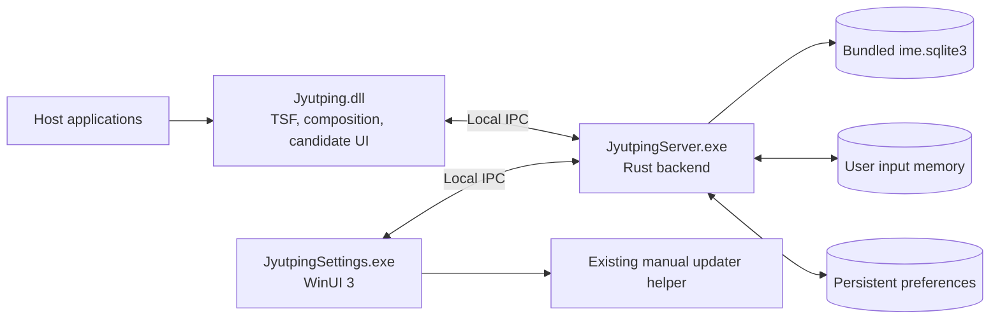

Plan: Move backend responsibilities into a Rust server and add a standalone WinUI 3 settings application.

Status: Proposed; investigation and implementation roadmap (2026-11-18).

# Client-Server Architecture And Settings Application Roadmap

## Objective

Evolve Jyutping into three cooperating components:

- `Jyutping.dll`: the existing in-process C++ TSF text service, responsible for interaction with host applications.
- `JyutpingServer.exe`: a new Rust backend, responsible for engines, input memory, persistent settings, and related data operations.
- `JyutpingSettings.exe`: a new WinUI 3 desktop application, providing the main settings window with an organization similar to the Mac version.

This document describes future work. The IPC transport, settings implementation language, and migration strategy are pending.

The architecture should reduce repeated backend initialization and centralize persistent writes. It must preserve correct typing behavior across supported host applications. Performance improvements require measurement; moving work into another process does not by itself make typing faster or prevent UI blocking.

## Current Baseline And References

The source tree at implementation time is authoritative. Earlier roadmaps describe historical schemas and responsibilities that may have changed.

| Existing area | Relevant behavior and integration point |
| --- | --- |
| `Jyutping/InputEngine.h`, `InputEngineFacade.cpp` | Existing facade for suggestions, reverse lookup, segmentation, and learning/forgetting. A useful starting point for the process boundary. |
| `Jyutping/CoreImeEngine.h`, `InputEngine*.cpp`, `Segmenter.*`, `PinyinSegmenter.*` | Lookup and segmentation behavior to port into Rust. |
| `Jyutping/Candidate.*`, `Converter.*`, `ImeTypes.*`, `VirtualInputKey.*` | Candidate presentation data, source lexicons, conversion, input encoding, and matching semantics. |
| `Jyutping/ImeDatabase.*` | Read-only bundled dictionary access. |
| `Jyutping/InputMemory.*` | Writable `%LOCALAPPDATA%\Jyutping\memory.sqlite3`, including current `memory2608` tables, legacy migration, learning, forgetting, and packaged-app journal handling. |
| `Jyutping/CompositionProcessorEngine.*` | Owns input buffers, selected-word learning sequences, settings, and cached suggestions. `GetInputSuggestions()` currently calls the engine synchronously. |
| `Jyutping/KeyEventSink.cpp`, `KeyHandler.cpp`, edit-session classes | TSF key handling, composition updates, candidate selection, partial consumption, and committing text. |
| `Jyutping/Settings.*`, `GlobalSettings.*` | Persistence under `HKCU\Software\Jyutping\Preferences` and live synchronization through TSF global compartments, including packaged and AppContainer hosts. |
| `Jyutping/LanguageBar.*`, `SettingsMenuModel.*`, `SettingsMenuWindow.*`, `OptionsView.*` | Existing quick controls. The language-bar settings menu is where the new `More Settings...` command will go. |
| `Jyutping/Server.cpp` | The current DLL COM class factory. Its name does not identify an existing backend executable; retain its TSF/COM role. |
| `preparing/` | Rust dictionary generator and source data; remains the source of truth for the bundled database. |
| `Version.targets`, `packaging/`, `JyutpingUpdater/` | Shared product version, native installation-path routing, two installer packages, and the separate manual updater. |

Use `C:\Users\bing\github\apple-jyutping` as a read-only behavior and UI reference. In particular, inspect `InputMethod/Preferences/SettingsContentView.swift`, the individual settings views, `AppSettings.swift`, and desktop CoreIME sources. Record the actual reference revision before porting behavior. Similar UI organization does not imply that Mac preference storage or memory files are compatible with Windows.

Relevant Microsoft documentation:

- [Named pipes](https://learn.microsoft.com/en-us/windows/win32/ipc/named-pipes)
- [CreateNamedPipeW, including AppContainer restrictions](https://learn.microsoft.com/en-us/windows/win32/api/namedpipeapi/nf-namedpipeapi-createnamedpipew)
- [Local RPC](https://learn.microsoft.com/en-us/windows/win32/rpc/local-rpc)
- [WinUI 3 overview and supported Windows versions](https://learn.microsoft.com/en-us/windows/apps/winui/winui3/)
- [Windows App SDK deployment for unpackaged applications](https://learn.microsoft.com/en-us/windows/apps/windows-app-sdk/deploy-unpackaged-apps)

## Scope And Product Boundaries

The target backend is Rust. A temporary bridge to existing C++ engine code is an optional migration technique, not the final backend architecture.

Preserve the 26-key QWERTY desktop input model. Exclude 9-key input, iOS ambiguous-key handling, and other keyboard layouts. Preserve current candidate ordering, character conversion, reverse lookup, punctuation, selection, and learning behavior unless a change is explicitly identified and reviewed as a product change.

Keep the existing Direct2D/DirectWrite candidate UI in the DLL for this migration. A WinUI settings application does not require a WinUI candidate window. Keep the updater in its existing helper process, with manual checks and automatic checks disabled as described in roadmap 19.

The initial architecture has no network backend, cloud synchronization, machine-wide Windows service, or requirement to keep the settings window open while typing. New settings should be introduced with their backend and rendering behavior, rather than as controls without an implemented effect.

## Target Ownership

| Component | Owns |
| --- | --- |
| TSF DLL | TSF interfaces and callbacks; key classification; authoritative local input buffer; composition lifetime and edit sessions; focus and caret tracking; candidate navigation/rendering; language bar and quick controls; cached settings and the current candidate snapshot. |
| Rust server | Segmentation and lookup engines; bundled dictionary connections; candidate source merging, ranking, conversion, and reading metadata; memory lookup and mutations; durable preference validation/storage; change notifications; background import/export jobs. |
| WinUI settings | Navigation, controls, live preview, file selection, progress and error presentation, and single-window activation. Uses backend commands for persistent data changes. |

TSF interfaces, edit cookies, context pointers, and window ownership stay in the client process. The server returns data; the DLL applies it through the appropriate TSF operations.

Initially, suggestion requests carry complete input snapshots and relevant options. The server must not maintain a single global composition buffer. Each context has independent request identity and cached results, while dictionary data, memory, and preferences are shared where appropriate.

Keep a platform-independent Rust core separate from Windows process, IPC, activation, and registry code. A possible layout is `backend/` with core and server crates, a protocol definition and fixtures under `Shared/Protocol/`, and a separate `JyutpingSettings/` project. Finalize the layout in the first implementation milestone without reorganizing `preparing/` unnecessarily.

## IPC Transport And Protocol

### Transport Selection

Named pipes are the first candidate. They provide local bidirectional communication, multiple client connections, and interoperability between C++, Rust, and C#. Local Windows RPC is the main alternative if it provides better coverage for the actual TSF hosts.

Do not select the transport solely from an unrestricted desktop demonstration. The DLL runs under its host's identity, package context, integrity level, and restrictions. Microsoft documents AppContainer restrictions on named pipes; changing pipe permissions alone must not be assumed to solve them. Prototype both connection and notification paths in representative restricted hosts before committing to a transport.

The selected endpoint must be local only, scoped to the user and logon session, and usable by the supported client architectures. Verify peer access and endpoint ownership. Endpoint discovery must use the canonical installation/session information rather than host executable paths or the host's Program Files view.

Keep transport details behind a small client interface so changing transport does not require rewriting engine or TSF behavior. Do not add localhost HTTP, shared-memory synchronization, or a second transport without evidence that the selected design needs them.

### Message Contract

Start with a small, versioned message contract. Length-prefixed UTF-8 JSON is a proposed initial format; choose the actual framing and serializer after the transport prototype. Use explicit field types and bounded frame sizes. Preserve 64-bit integer values exactly and serialize data independently of C++ structure layout, pointer width, or `wchar_t`. Define input counts in terms of typed key events, and specify the units of any text offsets so Rust UTF-8 indices cannot be confused with Windows UTF-16 offsets.

Define these identities separately:

- Protocol version and negotiated capabilities, independent of the product version.
- Server instance identity, changing when the backend restarts.
- Client/context identity and a composition generation that changes after reset or replacement.
- Request ID and input revision for matching responses to current input.
- Settings and memory revisions where changes invalidate cached results.

Suggested operations:

| Operation | Purpose |
| --- | --- |
| `Hello` / capabilities | Negotiate compatibility and return the server instance and current revisions. |
| `Suggest` | Query normal or reverse input using a full input snapshot, selected mode, and rendering-related engine options. Return candidates, reading metadata, and source information together. |
| `Cancel` / context close | Make obsolete work disposable and release context-associated resources. |
| `Remember`, `Forget` | Update memory using the original lexicon/source information, not converted display text alone. |
| `ClearMemory` | Perform an explicit user-requested clear with defined ordering relative to pending learning. |
| `GetSettings`, `SetSetting` | Read authoritative preferences or change a validated field. |
| `SettingsChanged`, `MemoryChanged` | Notify subscribed clients so cached settings/results can be refreshed. |
| Import/export job operations | Start, observe, cancel, and retrieve results for long-running memory transfers. |
| Activation/lifecycle operations | Support settings activation, health checks, and controlled shutdown where permitted. |

Do not turn every current C++ method into its own remote call. A suggestion response should supply the data needed for both reading and candidate presentation, avoiding multiple dependent IPC round trips per key.

Responses must distinguish an empty result from cancellation, incompatible versions, backend unavailability, invalid requests, and storage failure. Candidate identities must include their result/composition context; a candidate index by itself is not a durable identity.

Queries may be retried against a current snapshot. Define mutation acknowledgement and retry semantics explicitly: acknowledge successful persistence after the transaction commits, and never blindly replay an uncertain learning operation. If mutation replay is supported, operation IDs and transactional deduplication must prevent duplicate frequency increments.

## Typing, Asynchronous Results, And Failure Behavior

The client must continue making immediate key-consumption decisions. Key-test callbacks must not wait for engine results or trigger duplicate learning. IPC, server startup, database locks, and imports must not introduce unbounded waits into TSF callbacks or edit sessions.

The intended normal path is:

1. Classify and handle the key locally, update the authoritative input snapshot, and increment its revision.
2. Update the local composition preview and issue a suggestion request without holding a TSF document lock while waiting.
3. Receive the result on the IPC worker and marshal notification to the owning TSF thread.
4. Validate server identity, context/composition generation, input revision, and relevant settings revisions.
5. Update the reading/candidate state, requesting a TSF edit session whenever document changes require one.

Coalesce obsolete queries and bound outstanding work per context. Discard late results after input changes, cancellation, focus/context replacement, mode changes, or server restart. An IPC worker must not directly use apartment-bound TSF interfaces or update candidate UI after deactivation. Teardown must cancel callbacks and release workers safely before DLL unload.

Selection and finalization need an explicit ordering policy. In particular, Space or a number key pressed before the latest result arrives must never commit a candidate from an older input revision. Prototype a bounded ordered continuation for actions that need a current candidate, and specify how subsequent keys, cancellation, and focus changes interact with it. Avoid an indefinitely growing queue. Validate the policy before replacing the synchronous path throughout the DLL.

Failure behavior must be defined for both states:

- Before starting a composition, an unavailable backend must not cause keys to be consumed and lost. Use a known unavailable state while reconnect/startup proceeds outside the key callback.
- During composition, preserve local raw input and already selected text. Provide a deterministic local commit/cancel path, invalidate stale candidates, and recover without applying a result to a different document. An already consumed key cannot simply be passed through retroactively.

Backend failure may reduce candidate availability, but must not freeze the host, commit duplicate text, discard the composition silently, or require terminating the host application.

## Backend Lifetime And Concurrency

Run one normal-privilege backend per user/logon session, independently of the settings application and individual host processes. The installer may retain its existing elevation requirements; routine typing and settings changes must not require elevation.

Arrange dependable activation at user sign-in and test ordinary desktop on-demand activation as recovery. A restricted first host may be unable to launch the backend, so launch-on-first-key is insufficient. Keep startup out of `DllMain` and avoid blocking activation callbacks on backend initialization. Ensure singleton arbitration handles simultaneous startup attempts.

On disconnect, retain client input locally, invalidate server-bound identities, and reconnect with bounded backoff. After restart, establish fresh capabilities and settings, then resubmit only the current safe query. Clean up sessions when a client crashes. Closing the settings window must not stop the backend; exiting a host must not stop other clients.

Separate interactive lookup scheduling from expensive imports, exports, and maintenance. Bound queues, serialize dependent mutations, and prevent one client from starving others. A single blocked database operation must not stall every client's IPC handler.

Multiple logon sessions for the same user may open the same user database. A per-session server singleton is not a user-wide database lock. Coordinate migrations and use appropriate SQLite transactions and bounded busy handling across sessions. Also account for older, already loaded DLLs that may continue writing memory during an upgrade.

Keep diagnostics useful for request timing, reconnects, versions, and storage errors. Avoid logging typed input or learned vocabulary by default.

## Rust Engine And Data Migration

Port the current Windows behavior first, using the Mac implementation to clarify intent and separately record known differences. Preserve source ordering, deduplication, tone/apostrophe rules, partial input counts, reading marks, reverse lookup, character standards, supplementary candidates, and learning of the original lexicon after display conversion.

Preserve current database filenames, schemas, migration behavior, and key encodings during the process move wherever possible. Audit the actual `memory2608` implementation rather than adopting old `core_memory` or hash assumptions from earlier plans. Preserve signed 64-bit wrapping arithmetic and Unicode handling where the existing encoding depends on them.

The bundled dictionary remains generated by `preparing/`; do not silently regenerate a different contract as a side effect of the Rust port. Select and document the Rust SQLite dependency and deployment model, including whether Windows SQLite or a bundled library is used. Verify feature, journal, recovery, and locking compatibility with current installations.

Centralized ownership permits simpler file-access policy, but removing existing packaged-host compatibility code is safe only after those hosts use the backend successfully. During a transition, keep the old and new paths compatible with the same on-disk data. Separate any irreversible schema migration from the first process cutover, and define backup/recovery before introducing one.

A temporary C++ bridge can help establish process behavior before the Rust port is complete. If used, keep it behind the same data contract, contain exceptions at the boundary, preserve database ownership, and remove it once parity is established. Do not maintain two independently evolving production engines indefinitely.

## Settings Authority And Synchronization

The target server owns durable preferences. Preserve existing preference names, enum values, defaults, and migration rules initially. Clients keep validated snapshots and send field-level changes; they must not overwrite an entire newer settings snapshot with stale values.

Apply backend validation, assign a monotonically ordered revision within a server instance, and broadcast accepted changes. Reconnect returns a complete authoritative snapshot. Update notifications and query options must make it impossible for a response computed with an old character standard to become the new visible result accidentally.

Coordinate preferences across simultaneous sessions for the same user as well. Session-local notifications do not reach another session's backend. Observe durable-store changes, reconcile field-level writes with a documented conflict policy, and refresh each server's local revision/snapshot. Distinguish user-wide preferences from session-local live input mode; an external preference refresh must not unexpectedly finalize a composition in another session.

The DLL still translates settings into TSF compartments and applies mode changes through the correct composition/edit-session path. Preserve existing global-versus-context behavior. A persisted default and a live input-mode change are different concepts; do not change their meaning incidentally during this refactor.

Design an explicit transition from `SettingsStore` and `CGlobalSettings`. Existing TSF global compartments may remain a compatibility bridge while restricted hosts and old DLLs coexist. Define how legacy changes enter server authority, how echo notifications are suppressed, and how startup avoids promoting stale compartment values over newer persisted preferences. Retire duplicate persistence paths only after convergence and mixed-version behavior are verified.

Settings changes made while the backend is unavailable must be reported as pending or failed accurately. The UI must not claim a durable save that did not happen. After reconnect, reconcile against server state rather than replaying a stale full snapshot.

## WinUI 3 Settings Application

Use an unpackaged WinUI 3 desktop application compatible with the existing Inno Setup distribution. C# and XAML are the proposed default for UI development; C++/WinRT is a valid alternative if native deployment and avoiding a .NET runtime are preferred. Record this choice before creating the project. WinUI dependencies stay outside the TSF DLL.

Use `NavigationView` with a content area reflecting the Mac settings organization. Adapt interaction and appearance to Windows rather than copying Mac materials or controls literally.

| Page | Planned Windows behavior |
| --- | --- |
| General | Existing candidate page size, character variant/form, punctuation preferences, and supported candidate display options. |
| Appearance | Preview the Windows candidate window and expose implemented appearance preferences. New editable properties require corresponding renderer support. |
| Reverse Lookup | Explain supported modes and expose actual configurable behavior as it becomes available. |
| Tones | Explain the current tone-entry rules and expose implemented tone/comment options. |
| Fonts | Existing candidate, number, and comment sizes; add font modes/lists only together with persistence and renderer support. |
| Input Memory | Clear memory and provide learning controls and import/export once their backend contracts are implemented. |
| Hotkeys | Document current shortcuts; editable bindings require validation, conflict handling, and TSF registration support. |
| About | Product version, project links, and the existing manual update-check action. |

Publish the pages and controls that have meaningful behavior; Mac page parity does not require adding every Mac option to the first Windows release. Establish a concrete first-release control inventory during UI implementation.

Add a `More Settings...` command to the language-bar settings menu and an installed shortcut. Both open the settings application. Repeated activation should show the existing window. Validate launch and foreground activation from packaged/restricted hosts. Use a proven broker or registration path if direct process launch is unavailable.

Settings previews should use the same candidate data and appearance rules as the actual DLL. The settings UI owns user-selected files, dialogs, and destructive-action confirmation; the backend performs data validation and transactional changes. Long jobs report progress, cancellation, and failure without blocking typing. Coordinate clear/import with pending learning so pre-clear work cannot silently restore deleted entries.

Define a versioned Windows memory-transfer format before exposing import/export. Validate encoding, vocabulary identity, frequency/timestamp handling, duplicates, malformed records, and atomicity. Mac interoperability is a separate compatibility claim requiring inspected formats and verified conversion, not an assumed consequence of matching UI controls.

Reuse existing localization concepts and extend the new application's resources consistently. Cantonese (`yue`) and Hong Kong written Chinese (`zh-Hant-HK`) remain distinct. Use Windows font availability and include keyboard navigation, accessibility names, display scaling, light/dark appearance, and high-contrast verification.

## Builds, Installation, And Upgrades

Keep the existing DLL platform coverage. On x64 installations, x86 and x64 DLLs connect to one native x64 backend. On ARM64 installations, native ARM64 and emulated x64 clients using the ARM64X DLL connect to one native ARM64 backend. Build native x64/ARM64 server and settings payloads; do not infer their architecture from the invoking host.

Resolve executable paths from the canonical native `HKLM\Software\Jyutping\InstallPath` value in the 64-bit registry view. Preserve the ARM64 installer design without an x86 fallback, existing AppIds, TSF registration, and the generated Inno Setup uninstaller.

The x64 product requires Windows 10 version 1809 (build 17763) or later, which is the WinUI 3 minimum. The ARM64 product requires Windows 11 (build 22000) or later for ARM64X. Use these minimums for the server and settings application. Verify the selected Windows App SDK and, if applicable, .NET versions on the minimum supported builds.

Choose and document Windows App SDK deployment and, if C# is selected, .NET deployment. Compare prerequisite installation with self-contained distribution for size, offline installation, servicing, and clean-machine reliability. Add required licensing notices. An unpackaged UI does not remove runtime deployment requirements.

Extend the build/package pipeline to build and stage the Rust server and settings application alongside the existing payloads. Apply `version.txt` / `-AppVersion` consistently to all executable metadata and installer checks, while retaining separate protocol compatibility versions. Update solution/build entry points, CI, staging validation, signing hooks, and release documentation. Do not change the generator's database contract merely to share a build workspace.

Plan for loaded old DLLs, active backend connections, and open database files during upgrades. Negotiate compatible protocol versions or use an explicit supported transition; do not force-close host applications to replace them. Define backend quiescing, pending mutations, helper/settings shutdown, replacement, restart, and any required application restart or sign-out. Cover multiple logged-on sessions and the manual updater's installer handoff.

Uninstall removes installed executables and activation/startup registrations through the existing uninstaller. Preserve user memory/preferences by default. An older backend or DLL must not be directed at an incompatible new database after a cancelled, deferred, or failed upgrade.

## Implementation Milestones

### Milestone 0: Validate IPC And Typing Feasibility

On Windows 11 ARM64, the named-pipe probe delivered candidates in native RichEdit and packaged Notepad and received access denied under an AppContainer token. Local RPC delivered Rust dictionary candidates on the TSF threads of RichEdit, Notepad, and the packaged Clock AppContainer. An emulated x64 standalone client also received a candidate from the ARM64 listener.

The opt-in Debug ARM64 typing probe now uses local RPC replies for a single exact-spell candidate. Native RichEdit verified selection before and after replies, invalidation after typing or focus changes, and raw-input fallback on an empty reply, deadline expiry, or listener exit. Production endpoint authorization, sign-in activation, and validation of asynchronous typing across the supported hosts and architectures remain open. [Probe instructions and results](../experiments/ipc-probe/README.md#asynchronous-typing-over-local-rpc)

Build a small end-to-end prototype with the current DLL, a Rust backend, and a real candidate request. A narrow C++ bridge or minimal Rust engine slice is sufficient. Exercise named pipes first and compare local RPC where host restrictions require it.

Validate a restricted first host, backend-not-running startup, response delivery to the TSF thread, rapid input, Space before a response, cancellation, and backend restart. Record connection/lookup latency and callback blocking against the current in-process path, including cold startup and backend load. Establish measurable release budgets from those results rather than inventing latency guarantees.

Acceptance: a documented transport/activation choice covers representative supported hosts and architectures, with a demonstrated nonblocking candidate path and safe handling of the difficult selection/failure cases. An unrestricted console-to-console demonstration alone does not pass this milestone.

### Milestone 1: Establish The Protocol And Backend Host

Create the Rust core/server boundaries, canonical protocol definitions and fixtures, C++ IPC adapter, singleton activation, connection ownership, capability negotiation, framing limits, shutdown, and reconnect behavior. Define all identifiers and mutation retry rules before multiple consumers depend on them.

Acceptance: multiple clients can connect, isolate contexts, exchange versioned requests, survive malformed/incompatible peers, and reconnect after a restart without blocking host callbacks or duplicating mutations.

### Milestone 2: Port Engines And Input Memory To Rust

Port normal input, segmentation, reverse lookup, supplementary sources, conversion, and memory behavior in reviewable steps. Use focused golden cases and differential comparisons against the current Windows implementation; inspect Swift references for intended behavior. Include Unicode, tone/apostrophe edge cases, partial consumption, ordering, duplicates, and integer encoding.

Acceptance: representative engine results and learning/forgetting behavior match the established baseline; existing user databases migrate/open safely; a fresh install initializes correctly; concurrent sessions and interrupted transactions do not corrupt data. The completed production backend no longer depends on the temporary C++ bridge.

### Milestone 3: Integrate The Asynchronous TSF Client

Replace synchronous suggestion retrieval with revision-aware requests and cached snapshots. Integrate reading strings, partial candidate consumption, selection continuation, local failure behavior, and lifecycle cleanup. Keep candidate rendering and document edits in the DLL.

Acceptance: ordinary/reverse input, selection, punctuation, deletion, navigation, mode changes, focus changes, deactivation, and reconnect work without stale or duplicate commits. The server can be stopped or delayed while the host remains responsive and its input is preserved.

### Milestone 4: Consolidate Settings Ownership

Move durable preference writes to the backend, implement field-level commands and notifications, and complete the transition from global-compartment persistence. Verify quick controls, external settings changes, and old/new DLL coexistence.

Acceptance: all supported hosts converge on validated settings, changes survive sign-out, sandboxed or virtualized registry views cannot become authoritative accidentally, and server restart does not resurrect stale values.

### Milestone 5: Deliver The WinUI Settings Application

Select the UI language and runtime deployment approach, implement the agreed control inventory and live previews, and add the `More Settings...` command, single-window activation, and installed shortcuts. Implement supported memory transfer and management operations with their backend behavior.

Acceptance: settings work with normal privilege from a clean installation, repeated launches reuse the window, changes reach active DLL clients, memory operations preserve typing responsiveness, and localization/accessibility/scaling checks pass. Closing the window leaves typing functional.

### Milestone 6: Package And Validate The Installed Product

Extend both installers, native architecture routing, version/signing checks, runtime deployment, startup registration, and update/uninstall handling. Document diagnosis, supported host coverage, the protocol compatibility window, and migration/recovery behavior.

Acceptance: clean install, upgrade with hosts still running, backend crash/restart, multiple sessions, cancelled/deferred upgrade, and uninstall pass on the supported x64/ARM64 systems. Existing manual updates continue using the established signed feed and installer flow.

UI work may proceed against the settled protocol after milestone 1. Production cutover still depends on passing the engine, TSF, settings, and installed-product milestones.

## Verification And Release Gates

Use focused checks proportional to each implementation change. For C++ verification, use `Debug|ARM64` by default as required by `AGENTS.md`; run the broader payload/configuration matrix when packaging or cross-architecture validation requires it. Add meaningful Rust engine/protocol tests and integration coverage for the new process boundary rather than mechanically copying the entire Swift test suite.

| Area | Required coverage |
| --- | --- |
| Host compatibility | Classic Win32 editors, packaged desktop apps such as current Notepad, Chromium/Brave, Office or another complex TSF consumer, and an actual AppContainer/UWP host where currently supported. Distinguish a packaged desktop process from an AppContainer. |
| Execution context | Normal and elevated hosts, secure/comless/UI-less TSF modes where supported, multiple threads/contexts, multiple clients, and multiple logon sessions. Record unsupported cases explicitly. |
| Architecture | x86/x64 clients on x64 Windows; native ARM64 and emulated x64 clients using the ARM64X installation on ARM64 Windows. |
| Composition correctness | Fast typing, held/repeated keys, immediate Space/number selection, partial word consumption, reverse lookup, mode toggles, focus changes, cancellation, and application exit with requests pending. |
| Recovery and load | Cold start, missing/slow backend, server termination during a request, reconnect, lost mutation acknowledgements, full queues, malformed frames, stale replies, and imports concurrent with typing. |
| Persistence | Existing and fresh memory databases, schema migration, Unicode data, rollback after interrupted writes, cross-session contention, settings convergence, and clear/import ordering. |
| Deployment | Runtime prerequisites, offline install strategy, native executable routing, startup when the first host is restricted, loaded older DLLs, file replacement, manual update, failed/cancelled upgrade, and uninstall. |

The first production cutover is gated on demonstrated host compatibility and typing correctness, preserved user data, and an upgrade path that tolerates loaded old DLLs. Resolve transport, UI language, runtime deployment, and protocol compatibility policy in the corresponding milestones and record the decisions here as evidence becomes available.
